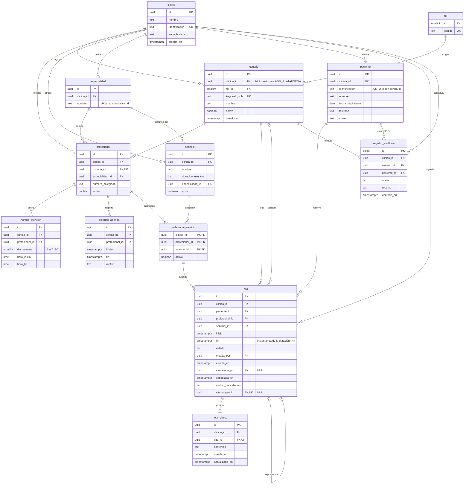

# MediCitas, Etapa 1: diseño de datos y consistencia

Este documento cubre la parte del documento de diseño que pide el enunciado (sección 5, módulos 1, 3, 6 y 8) sobre los datos:
el modelo y su normalización, el diccionario de datos, cómo se sostiene cada invariante, la decisión de aislamiento con sus
trade-offs, los índices justificados con el plan de ejecución y la caché de disponibilidad. Para cada decisión se indica qué
alternativas se consideraron, qué se ganó y qué se sacrificó.

La comparación de estrategias de multi-tenancy, la identidad delegada en Keycloak y los roles de base de datos se documentan
aparte, en [diseno-seguridad.md](diseno-seguridad.md). Aquí solo aparece lo que esas decisiones imponen al esquema. Este
documento amplía y pone al día las secciones 1 a 9 del borrador [diseno-modelo-logico.md](diseno-modelo-logico.md) con lo que finalmente se construyó (migraciones 001 a 011).

Las afirmaciones de este documento remiten a su prueba o a su medición. Los comandos para repetirlas están en
[db/README.md](../db/README.md) y [servicios/agenda/README.md](../servicios/agenda/README.md).


## Contenido

1. [Decisiones base](#1-decisiones-base)
2. [Diagrama entidad-relación](#2-diagrama-entidad-relación)
3. [Diccionario de datos](#3-diccionario-de-datos)
4. [Normalización hasta 3FN](#4-normalización-hasta-3fn)
5. [Desnormalizaciones deliberadas](#5-desnormalizaciones-deliberadas)
6. [Cómo se sostiene cada invariante](#6-cómo-se-sostiene-cada-invariante)
7. [Transacciones, aislamiento y concurrencia](#7-transacciones-aislamiento-y-concurrencia)
8. [Índices y plan de ejecución](#8-índices-y-plan-de-ejecución)
9. [Caché de disponibilidad](#9-caché-de-disponibilidad)
10. [Qué se sacrificó y límites conocidos](#10-qué-se-sacrificó-y-límites-conocidos)

## 1. Decisiones base

| Tema | Decisión | Alternativa descartada y por qué |
|---|---|---|
| Motor | PostgreSQL 16 | Otro motor relacional. PostgreSQL tiene restricciones de exclusión sobre rangos (`EXCLUDE USING gist`), que permiten que el propio motor impida dos citas solapadas (I1, I2). En otro motor habría que imitarlo con triggers o con lógica de la aplicación |
| Acceso a datos | SQL escrito a mano con psycopg 3, parametrizado, sin ORM | Un ORM. Las consultas críticas (disponibilidad, reserva) dependen de rangos, CTE y bloqueos de fila, y con SQL explícito se ve qué ejecuta el motor y con qué plan |
| Multi-tenancy | Columna discriminadora `clinica_id` con claves foráneas compuestas `(clinica_id, id)` | Esquema por clínica y Row-Level Security. Se comparan en [diseno-seguridad.md](diseno-seguridad.md) |
| Identificadores | `uuid` | Enteros secuenciales, que permiten adivinar ids de otra clínica y revelan cuántos registros hay |
| Tiempo | Citas y bloqueos como instantes `timestamptz`. El horario semanal como `time` en hora local, interpretado con `clinica.zona_horaria` | Guardar todo en hora local. Un instante absoluto no depende del cambio de hora ni de la zona de quien consulta; el horario semanal, en cambio, es una regla local que se repite |
| Credenciales | No se guardan. `usuario.keycloak_sub` enlaza con el proveedor | Lo exige el enunciado (módulo 4) |
| Borrado | Nada se borra de las tablas clínicas: bajas lógicas (`activo`) y estados finales de la cita | Borrar rompe el historial y las referencias de la bitácora |

## 2. Diagrama entidad-relación

Las restricciones no caben en el diagrama: están en el diccionario (sección 3) y en las migraciones de
[db/migrations/](../db/migrations/).



## 3. Diccionario de datos

Convenciones que valen para todas las tablas:

- Toda tabla que pertenece a una clínica lleva `clinica_id NOT NULL`, declara `UNIQUE (clinica_id, id)` si otra tabla la
  referencia, y sus claves foráneas son **compuestas** `(clinica_id, <columna>)`. Así el motor rechaza que una fila de una
  clínica apunte a una fila de otra (I5).
- "Nulo" indica si la columna admite `NULL`. Las columnas sin descripción de restricción solo tienen `NOT NULL` o nada.
- Los `id` se generan con `gen_random_uuid()`, salvo `rol.id` (catálogo fijo) y `registro_auditoria.id` (identidad).

### `clinica`: el tenant (RF1)

| Columna | Tipo | Nulo | Significado | Restricción |
|---|---|---|---|---|
| `id` | uuid | no | Identificador | PK |
| `nombre` | text | no | Nombre comercial | |
| `identificador` | text | no | Texto corto para URL y logs (`san-rafael`) | UNIQUE; CHECK minúsculas, números y guiones |
| `zona_horaria` | text | no | Zona IANA (`America/Costa_Rica`) con que se interpreta el horario semanal | La aplicación la valida contra `pg_timezone_names` |
| `creada_en` | timestamptz | no | Alta de la clínica | DEFAULT `now()` |

### `rol`: catálogo fijo de roles

| Columna | Tipo | Nulo | Significado | Restricción |
|---|---|---|---|---|
| `id` | smallint | no | 1 ADM_PLATAFORMA, 2 ADM_CLINICA, 3 RECEPCION, 4 PROFESIONAL | PK. Los valores son parte del contrato: el CHECK de `usuario` depende de que 1 sea la plataforma |
| `codigo` | text | no | Nombre del rol, igual al rol del realm de Keycloak | UNIQUE |

### `especialidad`: catálogo propio de cada clínica

| Columna | Tipo | Nulo | Significado | Restricción |
|---|---|---|---|---|
| `id` | uuid | no | Identificador | PK; UNIQUE `(clinica_id, id)` |
| `clinica_id` | uuid | no | Clínica dueña | FK a `clinica` |
| `nombre` | text | no | "Medicina general", "Pediatría" | UNIQUE `(clinica_id, nombre)` |

### `usuario`: identidad dentro del sistema (RF2)

| Columna | Tipo | Nulo | Significado | Restricción |
|---|---|---|---|---|
| `id` | uuid | no | Identificador | PK; UNIQUE `(clinica_id, id)` |
| `clinica_id` | uuid | sí | Clínica a la que pertenece | FK a `clinica`. CHECK `usuario_clinica_segun_rol`: nulo si y solo si el rol es ADM_PLATAFORMA |
| `rol_id` | smallint | no | Rol | FK a `rol` |
| `keycloak_sub` | text | no | Claim `sub` del token: une la identidad del proveedor con la clínica y el rol | UNIQUE |
| `nombre` | text | no | Nombre para mostrar | |
| `activo` | boolean | no | Baja lógica: un usuario inactivo pierde el acceso en la siguiente solicitud | DEFAULT true |
| `creado_en` | timestamptz | no | Alta | DEFAULT `now()` |

### `profesional`: datos del usuario con rol PROFESIONAL (RF3)

| Columna | Tipo | Nulo | Significado | Restricción |
|---|---|---|---|---|
| `id` | uuid | no | Identificador | PK; UNIQUE `(clinica_id, id)` |
| `clinica_id` | uuid | no | Clínica | Parte de las FK compuestas |
| `usuario_id` | uuid | no | Usuario al que corresponde. El nombre vive en `usuario` | UNIQUE; FK `(clinica_id, usuario_id)` a `usuario` |
| `especialidad_id` | uuid | no | Especialidad | FK `(clinica_id, especialidad_id)` a `especialidad` |
| `numero_colegiado` | text | no | Número de colegiado | |
| `activo` | boolean | no | Un profesional inactivo deja de ofrecer espacios | DEFAULT true |

### `servicio`: lo que la clínica ofrece (RF4)

| Columna | Tipo | Nulo | Significado | Restricción |
|---|---|---|---|---|
| `id` | uuid | no | Identificador | PK; UNIQUE `(clinica_id, id)` |
| `clinica_id` | uuid | no | Clínica | FK a `clinica` |
| `nombre` | text | no | "Consulta general" | UNIQUE `(clinica_id, nombre)` |
| `duracion_minutos` | integer | no | Duración que ocupa una cita de este servicio (I4) | CHECK `> 0` |
| `especialidad_id` | uuid | no | Especialidad requerida | FK `(clinica_id, especialidad_id)` a `especialidad` |
| `activo` | boolean | no | Un servicio inactivo no se puede reservar | DEFAULT true |

### `profesional_servicio`: qué servicios atiende cada profesional (RF4)

| Columna | Tipo | Nulo | Significado | Restricción |
|---|---|---|---|---|
| `clinica_id` | uuid | no | Clínica | PK compuesta |
| `profesional_id` | uuid | no | Profesional | PK; FK `(clinica_id, profesional_id)` a `profesional` |
| `servicio_id` | uuid | no | Servicio | PK; FK `(clinica_id, servicio_id)` a `servicio` |
| `activo` | boolean | no | Deshabilitar sin borrar: las citas existentes siguen apuntando a la pareja | DEFAULT true |

La clave primaria lleva `clinica_id` porque `cita` la referencia con tres columnas: así el motor solo deja agendar un servicio
que ese profesional tiene asociado.

### `horario_atencion`: horario semanal (RF5)

| Columna | Tipo | Nulo | Significado | Restricción |
|---|---|---|---|---|
| `id` | uuid | no | Identificador | PK |
| `clinica_id` | uuid | no | Clínica | Parte de la FK compuesta |
| `profesional_id` | uuid | no | Profesional | FK `(clinica_id, profesional_id)` a `profesional` |
| `dia_semana` | smallint | no | Día ISO: 1 lunes ... 7 domingo | CHECK entre 1 y 7 |
| `hora_inicio` | time | no | Inicio del bloque, hora local de la clínica | |
| `hora_fin` | time | no | Fin del bloque | CHECK `hora_fin > hora_inicio` |

Restricción de tabla `horario_sin_solape`: un profesional no tiene dos bloques solapados el mismo día
(`EXCLUDE USING gist` con el tipo `timerange`, creado en la migración 001). Una jornada partida son dos filas.

### `bloqueo_agenda`: vacaciones y permisos (RF6)

| Columna | Tipo | Nulo | Significado | Restricción |
|---|---|---|---|---|
| `id` | uuid | no | Identificador | PK |
| `clinica_id` | uuid | no | Clínica | Parte de la FK compuesta |
| `profesional_id` | uuid | no | Profesional | FK `(clinica_id, profesional_id)` a `profesional` |
| `inicio` | timestamptz | no | Inicio del bloqueo, instante absoluto | |
| `fin` | timestamptz | no | Fin | CHECK `fin > inicio` |
| `motivo` | text | no | "Vacaciones", "Congreso" | |

Un bloqueo nuevo no cancela citas: las que ya caen dentro se devuelven como lista de conflictos para que recepción decida.

### `paciente` (RF14)

| Columna | Tipo | Nulo | Significado | Restricción |
|---|---|---|---|---|
| `id` | uuid | no | Identificador | PK; UNIQUE `(clinica_id, id)` |
| `clinica_id` | uuid | no | Clínica | FK a `clinica` |
| `identificacion` | text | no | Cédula o documento | UNIQUE `(clinica_id, identificacion)`: la misma persona puede ser paciente de dos clínicas, pero no dos veces en una |
| `nombre` | text | no | Nombre completo | |
| `fecha_nacimiento` | date | no | Fecha de nacimiento | |
| `telefono` | text | sí | Contacto. Su lectura se audita (RF18) | |
| `correo` | text | sí | Contacto. Su lectura se audita (RF18) | |

### `cita` (RF9 a RF13)

| Columna | Tipo | Nulo | Significado | Restricción |
|---|---|---|---|---|
| `id` | uuid | no | Identificador | PK; UNIQUE `(clinica_id, id)` |
| `clinica_id` | uuid | no | Clínica | Parte de todas las FK |
| `paciente_id` | uuid | no | Paciente | FK `(clinica_id, paciente_id)` a `paciente` |
| `profesional_id` | uuid | no | Profesional | FK `(clinica_id, profesional_id, servicio_id)` a `profesional_servicio` |
| `servicio_id` | uuid | no | Servicio | La misma FK de tres columnas |
| `inicio` | timestamptz | no | Inicio de la cita | |
| `fin` | timestamptz | no | Instantánea de `inicio` + duración del servicio al reservar (I4) | CHECK `fin > inicio`; el trigger `cita_protegida` impide cambiarlo |
| `estado` | text | no | RESERVADA, ATENDIDA, AUSENTE, CANCELADA o REPROGRAMADA | CHECK con los cinco valores; DEFAULT RESERVADA |
| `creada_por` | uuid | no | Usuario que reservó | FK `(clinica_id, creada_por)` a `usuario` |
| `creada_en` | timestamptz | no | Momento de la reserva | DEFAULT `now()` |
| `cancelada_por` | uuid | sí | Quién canceló | FK a `usuario`. CHECK `cita_cancelacion_completa` |
| `cancelada_en` | timestamptz | sí | Cuándo | CHECK `cita_cancelacion_completa` |
| `motivo_cancelacion` | text | sí | Por qué | CHECK `cita_cancelacion_completa`: los tres campos llenos si y solo si el estado es CANCELADA |
| `cita_origen_id` | uuid | sí | Cita que esta reemplaza al reprogramar | UNIQUE (una sola sucesora); FK `(clinica_id, cita_origen_id)` a `cita`; CHECK distinta de `id` |

Restricciones de tabla:

- `cita_sin_solape_profesional` (I1): `EXCLUDE USING gist (profesional_id WITH =, tstzrange(inicio, fin, '[)') WITH &&)
  WHERE (estado IN ('RESERVADA','ATENDIDA','AUSENTE'))`.
- `cita_sin_solape_paciente` (I2): la misma con `paciente_id`.
- Trigger `cita_protegida` (migración 007): una cita que no está RESERVADA no admite cambios, y los datos de identidad e
  intervalo de ninguna cita se editan (RF13, I4).

El intervalo `[)` deja pasar dos citas contiguas (una termina a las 10:00, la otra empieza a las 10:00). Las citas ATENDIDA y
AUSENTE siguen ocupando su intervalo, para que el historial nunca tenga dos citas solapadas.

### `nota_clinica` (RF15)

| Columna | Tipo | Nulo | Significado | Restricción |
|---|---|---|---|---|
| `id` | uuid | no | Identificador | PK |
| `clinica_id` | uuid | no | Clínica | Parte de la FK compuesta |
| `cita_id` | uuid | no | Cita a la que pertenece. El profesional autor se deduce de ella | UNIQUE (a lo más una nota por cita); FK `(clinica_id, cita_id)` a `cita` |
| `contenido` | text | no | Texto de la nota | |
| `creada_en` | timestamptz | no | Creación | DEFAULT `now()` |
| `actualizada_en` | timestamptz | no | Última edición | DEFAULT `now()` |

### `registro_auditoria`: bitácora append-only (RF18, I6)

| Columna | Tipo | Nulo | Significado | Restricción |
|---|---|---|---|---|
| `id` | bigint | no | Orden de inserción, independiente del reloj | PK, `GENERATED ALWAYS AS IDENTITY` |
| `clinica_id` | uuid | no | Clínica | Parte de las FK compuestas |
| `usuario_id` | uuid | no | Quién leyó o escribió | FK `(clinica_id, usuario_id)` a `usuario` |
| `paciente_id` | uuid | no | De qué paciente | FK `(clinica_id, paciente_id)` a `paciente` |
| `accion` | text | no | LECTURA o ESCRITURA | CHECK |
| `recurso` | text | no | NOTA_CLINICA o CONTACTO_PACIENTE | CHECK |
| `ocurrido_en` | timestamptz | no | Momento | DEFAULT `now()` |

Los triggers `bitacora_sin_cambios` y `bitacora_sin_truncate` (migración 010) rechazan UPDATE, DELETE y TRUNCATE a
cualquier rol, dueño incluido. Los privilegios de la migración 011 son la otra barrera (ver [diseno-seguridad.md](diseno-seguridad.md)).

### Funciones

`cabe_en_horario(profesional, inicio, fin)` (migración 006) responde si el intervalo cabe entero en un bloque del horario
semanal, convirtiendo el instante a la zona de la clínica. Es la única definición de "cabe en el horario" (I3): la usan la
reserva, la reprogramación y la lista de citas que quedan fuera al quitar un horario, así que las tres nunca discrepan.

## 4. Normalización hasta 3FN

El esquema se obtuvo del modelo conceptual aplicando cada forma normal en orden. Para cada paso se indica qué se comprobó y
qué decisión concreta tomó el grupo por ese motivo.

### Primera forma normal: valores atómicos, sin grupos repetidos

Cada columna guarda un solo valor, y nada se representa como lista dentro de una celda:

- **Los servicios de un profesional** no son un arreglo en `profesional`: son filas de `profesional_servicio`.
- **Una jornada partida** (08:00-12:00 y 13:00-17:00) son dos filas de `horario_atencion`, no un campo con dos rangos.
- **Los rangos de tiempo no se guardan.** Se guardan `inicio` y `fin`, y el rango (`tstzrange`, `timerange`) se construye
  dentro de la restricción o de la consulta.
- **La cadena de reprogramaciones** no es una lista en la cita original: cada cita apunta a la anterior con `cita_origen_id`.

### Segunda forma normal: sin dependencias parciales de la clave

Solo importa en tablas con clave compuesta, porque con una clave simple no hay "parte" de la que depender.

- Todas las tablas tienen clave primaria simple, salvo `profesional_servicio`.
- En `profesional_servicio` (clave `clinica_id, profesional_id, servicio_id`), el único atributo no primo es `activo`, y depende
  de la pareja completa: un profesional puede tener un servicio habilitado y otro no.
- Las claves candidatas compuestas (`especialidad (clinica_id, nombre)`, `servicio (clinica_id, nombre)`,
  `paciente (clinica_id, identificacion)`) tampoco tienen atributos que dependan solo de una parte: el nombre de un servicio no
  determina su duración sin saber de qué clínica es.

### Tercera forma normal: sin dependencias transitivas

Ningún atributo no primo depende de otro atributo no primo. Las decisiones que esto obligó:

| Dato | Dónde vive | Lo que se evitó |
|---|---|---|
| Nombre de la especialidad | `especialidad` | Repetirlo en `servicio` y `profesional`: `servicio.especialidad_id → especialidad.nombre` |
| Código del rol | `rol` | Guardar el texto del rol en `usuario` |
| Nombre del profesional | `usuario` | `profesional` no tiene nombre: lo toma del usuario por `usuario_id` |
| Zona horaria | `clinica` | Copiarla a `horario_atencion` o `cita` |
| Duración del servicio | `servicio` | Guardar la duración en `profesional_servicio` o en `cita` (ver la desnormalización 5.2, que es distinta) |
| Profesional autor de una nota | Se deduce de `nota_clinica.cita_id → cita.profesional_id` | Guardarlo en `nota_clinica` crearía la dependencia `cita_id → profesional_id` dentro de la nota |

Dependencias funcionales de cada tabla:

| Tabla | Dependencias funcionales relevantes | Resultado |
|---|---|---|
| `clinica` | `id → todo`; `identificador` es clave candidata | 3FN |
| `rol` | `id → codigo`; `codigo` es clave candidata | 3FN |
| `especialidad` | `id → todo`; `(clinica_id, nombre)` es clave candidata | 3FN |
| `usuario` | `id → todo`; `keycloak_sub` es clave candidata | 3FN |
| `profesional` | `id → todo`; `usuario_id` es clave candidata, así que `clinica_id`, que se deduce de él, depende de una clave y no es transitiva | 3FN |
| `servicio` | `id → todo`; `(clinica_id, nombre)` es clave candidata | 3FN |
| `paciente` | `id → todo`; `(clinica_id, identificacion)` es clave candidata | 3FN |
| `nota_clinica` | `id → todo`; `cita_id` es clave candidata, así que `clinica_id` depende de una clave | 3FN |
| `horario_atencion`, `bloqueo_agenda`, `cita`, `registro_auditoria` | `clinica_id` se deduce de `profesional_id` o de `paciente_id`, que **no** son claves candidatas | Desnormalización 5.1 |
| `profesional_servicio` | `profesional_id → clinica_id`, pero `clinica_id` es parte de la clave (atributo primo): no rompe la 3FN, aunque sí la forma normal de Boyce-Codd | 3FN, no FNBC, por la misma razón que 5.1 |
| `cita` | `fin` es función de `inicio` y de la duración del servicio | Desnormalización 5.2 |

### Catálogos como texto con CHECK

`cita.estado`, `registro_auditoria.accion` y `registro_auditoria.recurso` son texto con CHECK, no tablas catálogo. No es una
desnormalización: el valor no determina ningún otro atributo, así que no hay dependencia transitiva que separar. Se eligió así
porque los valores son fijos, los usa la lógica (un estado nuevo exige cambiar código de todas formas) y un CHECK impide valores
inválidos igual que una clave foránea, sin una unión extra en cada consulta. `rol` sí es tabla porque su id participa en un
CHECK y se comparte con Keycloak.

## 5. Desnormalizaciones deliberadas

### 5.1 `clinica_id` repetido en las tablas hijas

- **Qué rompe:** en `horario_atencion`, `bloqueo_agenda`, `cita` y `registro_auditoria`, `clinica_id` se puede deducir de
  `profesional_id` o de `paciente_id`. Es una dependencia transitiva.
- **Por qué se acepta:** es lo que permite las claves foráneas compuestas `(clinica_id, id)`. Con ellas, una cita de la clínica A
  no puede apuntar a un paciente, profesional o servicio de la clínica B aunque la aplicación tenga un error, porque la pareja
  `(A, id del paciente de B)` no existe en `paciente`. Además, toda consulta puede filtrar por clínica sin unir tablas.
- **Qué cuesta:** una columna más por tabla, un `UNIQUE (clinica_id, id)` adicional en cada tabla referenciada y claves foráneas
  más anchas.
- **Riesgo que introduce y cómo se neutraliza:** el riesgo clásico de repetir un dato es que las copias diverjan, por ejemplo una
  cita con `clinica_id = A` y un profesional de B. Aquí no puede ocurrir: la clave compuesta obliga a que la copia coincida.
- **Alternativas consideradas:**
  - Claves simples y la clínica validada solo en la aplicación: un error en una ruta basta para mezclar clínicas.
  - Triggers que verifiquen la clínica: más código y más puntos de fallo para lo que una clave foránea ya hace.
  - RLS: aísla las lecturas, pero las comprobaciones de clave foránea lo ignoran, así que no impide una referencia cruzada al
    escribir.

### 5.2 `cita.fin` como instantánea

- **Qué rompe:** `fin` se podría calcular como `inicio` más `servicio.duracion_minutos`.
- **Por qué se acepta:**
  - **I4.** La duración de un servicio se puede editar. Si `fin` se calculara con la duración actual, alargar un servicio movería
    las citas ya reservadas y podría solaparlas entre sí. Con la instantánea, las citas existentes conservan la duración con que
    se reservaron, y reprogramar también la conserva.
  - **I1 e I2.** La restricción de exclusión solo puede mirar la propia fila: necesita el intervalo completo guardado en ella.
- **Qué cuesta:** que `fin` sea correcto depende de quien inserta. Lo asegura la reserva, que lee la duración del servicio dentro
  de su transacción. Después, el trigger `cita_protegida` impide modificar `fin`.
- **Alternativa equivalente:** guardar `duracion_minutos` como instantánea y derivar `fin` con una columna generada. Es la misma
  desnormalización con otra forma; se prefirió `fin` porque es lo que leen la exclusión y todas las consultas.

## 6. Cómo se sostiene cada invariante

| Invariante | Mecanismo | ¿Lo exige el motor? | Prueba principal |
|---|---|---|---|
| I1: un profesional sin citas vigentes solapadas | Exclusión `cita_sin_solape_profesional`. Bloqueo de fila sobre el profesional para ordenar la espera | **Sí** | `test_ocho_clientes_compiten_por_el_ultimo_espacio_y_gana_uno_I1` ([servicios/agenda/tests/test_concurrencia.py](../servicios/agenda/tests/test_concurrencia.py)) |
| I2: un paciente sin citas vigentes solapadas | Exclusión `cita_sin_solape_paciente`; la clínica la fija la clave compuesta | **Sí** | `test_un_paciente_no_puede_estar_en_dos_consultas_a_la_vez_I2` |
| I3: la cita cae en el horario y fuera de bloqueos | `cabe_en_horario` y la búsqueda de bloqueos, dentro de la transacción, después de tomar el bloqueo de fila del profesional, que también toman quienes crean bloqueos o cambian horarios | **No**: lógica transaccional | `test_un_bloqueo_y_una_reserva_simultaneos_nunca_dejan_una_cita_dentro_del_bloqueo_sin_avisar_I3` y la de quitar un horario |
| I4: la duración la decide el servicio | `fin` calculado al reservar (5.2) y el trigger `cita_protegida` que impide editarlo | **Sí**, después de insertar | `test_la_duracion_se_conserva_aunque_el_servicio_haya_cambiado_I4`, `test_el_motor_rechaza_editar_la_duracion_I4` |
| I5: ninguna clínica ve datos de otra | Claves foráneas compuestas; la clínica sale de la sesión, nunca de la solicitud | **Sí** para escrituras; las lecturas dependen del filtro de la aplicación | Barrido de todas las rutas de los tres servicios ([servicios/pruebas_comunes/aislamiento.py](../servicios/pruebas_comunes/aislamiento.py)) |
| I6: bitácora sin modificación ni borrado | Trigger de la migración 010 y privilegios de la migración 011 | **Sí** | `test_el_motor_rechaza_modificar_o_borrar_la_bitacora_I6`, `test_ningun_rol_de_la_aplicacion_puede_modificar_ni_borrar_la_bitacora_I6` |
| I7: cancelar o reprogramar libera el espacio | CANCELADA y REPROGRAMADA quedan fuera del `WHERE` de las exclusiones; la caché se invalida tras el COMMIT | **Sí** en la base; la visibilidad depende de la caché (I8) | `test_reprogramar_libera_el_espacio_viejo_y_ocupa_el_nuevo_I7`, `test_cancelar_devuelve_el_espacio_de_inmediato` |
| I8: la disponibilidad no contradice la base | Clave versionada por profesional, invalidación tras el COMMIT y antes de la respuesta | **No**: política de caché (sección 9) | `test_i8_reservar_y_volver_a_consultar_muestra_el_espacio_tomado` ([servicios/agenda/tests/test_cache.py](../servicios/agenda/tests/test_cache.py)) |

Las restricciones también se prueban directamente contra el motor, sin la API, en
[db/pruebas/restricciones.sql](../db/pruebas/restricciones.sql). Las pruebas se validaron plantando errores a propósito en el
código (mutaciones) y comprobando que alguna fallara.

## 7. Transacciones, aislamiento y concurrencia

### 7.1 El problema

La pregunta rectora: dos recepcionistas reservan a la vez el último espacio libre de un profesional. Un diseño ingenuo
("consulto si está libre y, si lo está, inserto") falla: entre la consulta y la inserción la otra transacción puede insertar
también, y las dos ven el espacio libre. Ese patrón de comprobar y después actuar no es seguro en ningún nivel de aislamiento
inferior a SERIALIZABLE.

### 7.2 Nivel elegido: READ COMMITTED, fijado de forma explícita

Cada conexión del pool se abre con `default_transaction_isolation = read committed`
([servicios/comun/medicitas_comun/app.py](../servicios/comun/medicitas_comun/app.py)), y una prueba comprueba que es el nivel activo
(`test_el_nivel_de_aislamiento_activo_es_read_committed`).

**Qué configura la herramienta por omisión.** No se usa ORM. psycopg 3 abre una transacción implícita con la primera sentencia
(no está en modo autocommit) y no fija el nivel: usa el del servidor, que en PostgreSQL es READ COMMITTED. El grupo lo fija
igual, de forma explícita, para que un cambio en la configuración del servidor no altere el comportamiento sin avisar.

**Qué anomalías evita y cuáles permite READ COMMITTED, y cómo se cubren las que permite en los caminos críticos:**

| Anomalía | ¿La permite READ COMMITTED? | Cómo se cubre donde importa |
|---|---|---|
| Lectura sucia | No | |
| Lectura no repetible | Sí | La reserva no depende de releer: valida y luego inserta, y la exclusión decide |
| Fantasma | Sí | El solape lo decide la exclusión, que es atómica, no un `SELECT` previo |
| Actualización perdida | Sí, en leer-modificar-escribir | Las operaciones sobre una cita bloquean su fila y vuelven a leer el estado; la segunda ve el estado que dejó la primera y recibe 409 (`test_dos_operaciones_sobre_la_misma_cita_gana_una_RF13`) |
| Write skew (dos transacciones leen, deciden y escriben cosas distintas) | Sí | Es el caso de una reserva y un bloqueo de agenda simultáneos (I3). Ambos toman el bloqueo de fila del mismo profesional, así que se ejecutan de una en una |

### 7.3 Cómo se resuelve la reserva

Una sola transacción ([servicios/agenda/app/reserva.py](../servicios/agenda/app/reserva.py)):

1. `SELECT … FOR NO KEY UPDATE` sobre la fila del profesional y luego sobre la del paciente, siempre en ese orden.
2. Validar que existen en la clínica de la sesión (I5) y que están activos, y que el profesional atiende el servicio.
3. Calcular `fin` con la duración del servicio (I4) y comprobar el horario y los bloqueos (I3).
4. Insertar. Si el intervalo choca, la exclusión rechaza con SQLSTATE `23P01` y la API responde **409 "El horario ya está
   ocupado"**.
5. COMMIT, invalidar la caché y solo entonces responder.

Con dos solicitudes simultáneas para el mismo espacio, la segunda espera en el paso 1. Cuando la primera confirma, la segunda
continúa; en READ COMMITTED cada sentencia toma una foto nueva, así que su búsqueda de bloqueos y su inserción ven la cita
recién confirmada, y la exclusión la rechaza. Resultado: exactamente una reserva concedida.

**Dos barreras con funciones distintas:**

- **La exclusión es la garantía.** Está declarada en la tabla y vale para cualquier inserción: otra ruta, otro servicio, un
  script o una consola SQL.
- **El bloqueo de fila ordena la espera.** Sin él, I1 seguiría garantizada por la exclusión, pero las validaciones de I3 (que no
  son una restricción del motor) podrían correr con datos viejos, y se producían deadlocks (7.5).

La prueba de carrera levanta un servidor uvicorn real y lanza 8 clientes al mismo espacio durante 12 rondas. En cada ronda hay
exactamente un 201 y siete 409, todos los rechazos vienen de `cita_sin_solape_profesional`, y en la base queda una sola fila.

### 7.4 Alternativas consideradas

| Alternativa | Qué se ganaba | Por qué no |
|---|---|---|
| `SELECT` previo y luego `INSERT` | Simplicidad | Tiene la carrera de 7.1: las dos transacciones ven el espacio libre |
| REPEATABLE READ | Una foto estable de toda la transacción | La foto se toma en la primera sentencia, **antes** de esperar el bloqueo. Después de esperar, la reserva no vería un bloqueo de agenda que la otra transacción confirmó, e I3 se rompería sin ningún error. Además, una fila ya modificada por otra transacción aborta con `40001` |
| SERIALIZABLE | El motor detecta solo las anomalías, incluido el write skew de I3, sin bloqueos manuales | Aborta con `40001` justamente en los casos disputados, también con falsos positivos, y obliga a reintentar la transacción completa en todas las rutas que escriben. Con READ COMMITTED y un bloqueo explícito, la segunda solicitud espera y recibe una respuesta definitiva; el comportamiento es predecible y se puede probar |
| Bloqueo optimista (columna de versión en `profesional`) | Sin esperas | Cada conflicto se convierte en un error que hay que reintentar, y obliga a escribir en `profesional` en cada reserva |
| `pg_advisory_xact_lock` sobre el id del profesional | Bloqueo sin tocar la fila | Es una convención: no aparece en el esquema, una ruta nueva puede olvidarlo y otros servicios no lo ven. El bloqueo de fila protege lo mismo usando la fila real |
| `FOR UPDATE` en vez de `FOR NO KEY UPDATE` | | `FOR UPDATE` también bloquea las comprobaciones de clave foránea de otras transacciones (que toman `FOR KEY SHARE`), por ejemplo la fila de bitácora que el servicio de plataforma inserta sobre ese mismo paciente. `FOR NO KEY UPDATE` es exclusivo entre reservas sin frenar esas comprobaciones |
| `FOR SHARE` | Varias reservas leen a la vez | Producía deadlocks (7.5) |
| Bloqueo en Python o en Redis | | Un bloqueo de Python vive en un solo proceso, y en producción hay varios procesos y réplicas. Un bloqueo en Redis puede vencer antes de que la operación termine, y Redis no es la fuente de verdad. La base es el único lugar que comparten todas las solicitudes |

### 7.5 Conflicto y deadlock

Son dos fallos distintos y se tratan distinto:

| | Conflicto | Deadlock |
|---|---|---|
| Qué es | El espacio de verdad está ocupado | Dos transacciones se esperan mutuamente: cada una tiene un bloqueo que la otra necesita |
| Error del motor | `23P01` (exclusión) | `40P01`; PostgreSQL detecta el ciclo y cancela una de las dos |
| Respuesta | 409, sin reintentar: reintentar daría lo mismo | La API reintenta hasta 3 veces con una espera al azar creciente (`reintentar_si_deadlock` en [servicios/comun/medicitas_comun/transacciones.py](../servicios/comun/medicitas_comun/transacciones.py)). Si persiste, 503 con `Retry-After: 1` |

**Cómo se previenen los deadlocks:** todas las operaciones toman los bloqueos en el mismo orden global: profesional de destino,
paciente, cita. Si todos piden los recursos en el mismo orden, no se puede formar un ciclo de espera.

**Lo que se midió:** con `FOR SHARE` sobre el profesional, 8 clientes disputando un espacio producían deadlocks. Dos reservas
tenían el bloqueo compartido de la misma fila y las dos esperaban, al insertar, a la otra. Con `FOR NO KEY UPDATE` la segunda
espera **antes** de insertar y recibe un 409 limpio. El reintento quedó como red de seguridad, y se prueba con un deadlock real
provocado a propósito (`test_deadlock_real_dos_transacciones_que_se_piden_los_bloqueos_al_reves`).

**Reprogramar** (RF10) es una sola transacción: primero marca la cita vieja como REPROGRAMADA y después inserta la nueva. La
exclusión se revisa fila por fila, así que en el orden contrario mover una cita 15 minutos chocaría consigo misma. Si el espacio
nuevo está tomado, toda la transacción se deshace y la cita original queda RESERVADA.

### 7.6 Límites para que una espera no tumbe el servicio

| Ajuste | Valor | Por qué |
|---|---|---|
| `lock_timeout` | 5 s | Una espera normal dura milisegundos. Si algo retiene un bloqueo más tiempo, la solicitud responde 503 con `Retry-After: 1` en vez de quedar colgada. Sin límite, las solicitudes en espera ocuparían las 10 conexiones del pool y el servicio dejaría de atender a todos |
| `idle_in_transaction_session_timeout` | 30 s | Una transacción de la aplicación que quedó abierta sin actividad se cierra y se deshace, y libera sus bloqueos |
| COMMIT antes de la respuesta | | Con el valor por omisión de FastAPI, el 201 salía antes del COMMIT (medido). Ahora la transacción se confirma antes de responder (`test_el_commit_ocurre_antes_de_enviar_la_respuesta`) |

Ambos ajustes se aplican a las conexiones de las APIs, no a toda la base.

## 8. Índices y plan de ejecución

### 8.1 Método

Con los datos semilla (unas 2 000 citas) los planes muestran recorridos secuenciales, y es la decisión correcta: con tablas
chicas leerlas enteras es más barato que usar un índice. Por eso los índices se midieron con
[db/pruebas/historial_sintetico.sql](../db/pruebas/historial_sintetico.sql), que agrega dos años de historial y 2 000 clínicas
(unas 83 mil citas y 50 mil bloqueos), como en un SaaS con muchos clientes. El script
[servicios/agenda/tests/medir_consultas.py](../servicios/agenda/tests/medir_consultas.py) corre el mismo SQL que la API 50 veces y con `--plan` muestra
el plan de cada consulta.

### 8.2 RF7, la consulta que más se ejecuta

La disponibilidad (RF7) busca, para un profesional y un día, las citas vigentes y los bloqueos que se solapan con cada espacio
candidato:

```sql
-- citas (simplificado)
ci.profesional_id = $1 AND tstzrange(ci.inicio, ci.fin, '[)') && <espacio> AND ci.estado IN ('RESERVADA','ATENDIDA','AUSENTE')
-- bloqueos (simplificado)
b.profesional_id = $1 AND tstzrange(b.inicio, b.fin, '[)') && <espacio>
```

Lo que mostró el plan con volumen:

- **Las citas ya usaban un índice:** el GiST que el motor crea para la restricción de I1, `cita_sin_solape_profesional`. Tiene la
  misma expresión y el mismo predicado parcial que la consulta. **No se agregó un índice nuevo para las citas de RF7:** sería
  redundante y haría más lenta cada reserva, porque toda inserción actualiza todos los índices de la tabla.
- **Los bloqueos se leían enteros.** `bloqueo_agenda` guarda los bloqueos de todas las clínicas y crece sin parar. Se agregó
  `bloqueo_por_profesional_y_rango`, un GiST sobre `(profesional_id, tstzrange(inicio, fin, '[)'))`. Es GiST y no B-tree porque
  el operador de solape `&&` entre rangos no lo sirve un B-tree. Con él, RF7 bajó de **4,39 ms a unos 1,5 ms**.

### 8.3 Todos los índices agregados

| Índice (migración) | Consulta que sirve | Antes | Después |
|---|---|---|---|
| `bloqueo_por_profesional_y_rango` (008) | RF7, un profesional y un día | 4,39 ms | ~1,5 ms |
| | RF8, toda la clínica y 7 días (también cambió la consulta, ver 8.4) | 25,0 ms | ~6 ms |
| | RF9, ¿la reserva cae en un bloqueo? | 2,66 ms | ~0,1 ms |
| | RF6, listar bloqueos | 3,88 ms | ~0,1 ms |
| `cita_reservadas_por_profesional` (008), parcial `WHERE estado = 'RESERVADA'` | RF5 y RF6, citas en conflicto con un bloqueo u horario | 4,29 ms (leía 6 867 citas para devolver 86) | ~0,65 ms |
| | RF2, citas pendientes al dar de baja un usuario | 2,25 ms | ~0,12 ms |
| `cita_por_clinica_e_inicio` (009) | RF20, agenda del día de una clínica, y RF21 | 126 ms (leía `cita` entera) | ~2,2 ms |

Medianas en la misma computadora. El índice parcial solo guarda la agenda pendiente: una cita deja de ser RESERVADA al
resolverse, así que ocupa unos 40 kB contra 10 MB del GiST de I1 y no crece con el historial.

### 8.4 Decisiones sobre la consulta, no sobre el índice

- **La consulta de espacios no se prepara (`prepare=False`).** Preparada, PostgreSQL puede pasar tras varias ejecuciones a un plan
  genérico que no sabe si el profesional es nulo (RF8 consulta todos) y lee las tablas enteras. Medido forzándolo: RF7 de 1,2 a
  99 ms y RF8 de 24 a 1 384 ms. Planificar cada vez cuesta alrededor de 1 ms.
- **Los profesionales habilitados se calculan en un CTE `MATERIALIZED`.** Sin él, en RF8 el motor generaba los espacios de todos
  los profesionales y descartaba al final a quien no atiende el servicio: 1 120 búsquedas en vez de 280.

### 8.5 Costos

- Cada índice hace más lenta cada escritura en su tabla. Por eso no se agregó ninguno sin una consulta medida que lo necesitara.
- `CREATE INDEX` bloquea las escrituras de la tabla mientras se construye, porque cada migración corre en una transacción. En
  producción, con tablas grandes, se usaría `CREATE INDEX CONCURRENTLY`, que no puede ir dentro de una transacción.

## 9. Caché de disponibilidad

### 9.1 Qué se guarda y con qué clave

Redis guarda copias de la respuesta de RF7 (un profesional, un servicio, un día). La clave lleva todo lo que cambia la
respuesta y nada más:

```
disp:{clinica}:{profesional}:v{version}:{servicio}:{duracion}:{fecha}
```

- **La clínica** va en la clave, y además la clínica, el servicio y el profesional se validan en la base antes de leer la caché.
  Nadie de otra clínica llega a una copia (I5), y un profesional desactivado deja de aparecer al instante.
- **La duración** va en la clave: si se edita un servicio, la clave cambia sola y no hace falta invalidar.
- **La versión** es un contador por profesional.

### 9.2 Política de invalidación

Invalidar es **subir la versión** del profesional (`INCR`) **después del COMMIT y antes de la respuesta**. Las copias anteriores
quedan bajo claves que nadie vuelve a buscar, y un TTL de 5 minutos las borra. Suben la versión: reservar, cancelar, reprogramar
(los dos profesionales, si cambia), y crear o quitar horarios y bloqueos.

| Alternativa | Por qué no |
|---|---|
| Borrar las copias (`DEL`) al cambiar la agenda | Una consulta lenta que empezó antes del cambio puede guardar su copia vieja **después** del borrado, y quedaría como válida. Además, habría que encontrar todas las claves (cada fecha y cada servicio). Con la versión leída **antes** de calcular, esa copia tardía queda con el número anterior y nadie la lee (`test_una_copia_tardia_de_antes_de_invalidar_nadie_la_lee`) |
| Solo TTL, sin invalidar | Durante el TTL se ofrecería un espacio ya tomado: viola I8 |
| Actualizar la copia al reservar | Duplicaría la lógica de disponibilidad fuera de la base |
| Invalidar antes del COMMIT | Otra consulta podría recalcular y guardar la agenda sin ver el cambio todavía no confirmado |

### 9.3 La incoherencia que queda

- **Entre el COMMIT y el `INCR`**, unos milisegundos, otra consulta puede leer la copia anterior. Quien reservó nunca la ve,
  porque su respuesta sale después del `INCR`.
- **Si el `INCR` falla y Redis conserva sus datos** (por ejemplo, un corte de red), la copia vieja dura como mucho el TTL, 5
  minutos. Si Redis se reinició, quedó vacío y no hay nada que invalidar.
- **En ningún caso hay doble reserva:** la reserva nunca lee la caché. Lo peor que puede pasar es que se ofrezca un espacio ya
  tomado y, al reservarlo, la respuesta sea 409.

### 9.4 Redis no es fuente de verdad

Redis corre sin disco, a propósito: un respaldo reviviría copias que quizá ya son falsas. Si Redis falla o no responde, las
consultas salen de la base y las escrituras responden normal, con un aviso en el log. Cada acceso a Redis tiene un límite de
250 ms: sin él, con el contenedor apagado cada solicitud tardaba unos 3,9 s (la resolución del nombre no la cubre el tiempo de
espera del socket); con él, unos 280 ms (`test_redis_colgado_no_retrasa_mas_que_el_limite`).

### 9.5 Antes y después

Una solicitud de RF7 contra la API real con el historial sintético, medianas
([servicios/agenda/tests/medir_cache.py](../servicios/agenda/tests/medir_cache.py)):

| | Sin caché | Con la copia en Redis | Con caché, sin copia |
|---|---|---|---|
| Con los índices de la sección 8 | 9,6 ms | 7,4 ms | 11,6 ms |
| Sin esos índices | 17,5 ms | 8,2 ms | 20 ms |

Con los índices, una copia ahorra unos 2 ms (entre 1,2 y 1,4 veces menos latencia), porque la consulta en la base ya cuesta cerca
de 1,5 ms. Sin los índices ahorra más del doble. Índices y caché atacan el mismo costo: los índices mantienen barato el caso sin
copia, y la caché protege cuando la consulta crece. Es una comparación sencilla en una sola computadora, con un ruido de hasta
±30 % entre corridas; las pruebas de carga corresponden a la Etapa 2.

## 10. Qué se sacrificó y límites conocidos

| Decisión | Qué se sacrificó | Cuándo se reconsideraría |
|---|---|---|
| I3 como lógica transaccional y no como restricción | El motor no impide por sí solo una cita fuera de horario insertada por un camino que no tome el bloqueo del profesional | Si aparecieran más caminos que insertan citas: un trigger que llame a `cabe_en_horario` |
| Horario semanal sin vigencia | Un cambio de horario se aplica hacia adelante y no deja historial de cuál regía antes | Si se necesita auditar horarios pasados: agregar un rango de vigencia |
| READ COMMITTED con bloqueos explícitos | Cada ruta que escribe debe tomar sus bloqueos en el orden acordado; es una regla del código, no del motor | Si las rutas que escriben crecieran mucho: SERIALIZABLE con reintento general |
| Lecturas aisladas por el filtro de la aplicación | Una consulta que olvide filtrar por clínica filtraría datos; lo cubre el barrido de I5 | RLS como capa adicional ([diseno-seguridad.md](diseno-seguridad.md)) |
| Nota clínica solo sobre cita ATENDIDA y de su profesional | La comprueba la aplicación, porque un CHECK no puede mirar otra tabla | Un trigger, si otro servicio llegara a escribir notas |
| Sin caché en RF8 y en la reserva | RF8 siempre consulta la base | Si RF8 se volviera un cuello de botella medido |
| Índices creados sin `CONCURRENTLY` | Bloquean escrituras mientras se construyen | En producción con tablas grandes |
| Historial del paciente (RF16) y bitácora (RF19) sin índices medidos | No se midió su plan con volumen | Al medirlos con el historial sintético |
