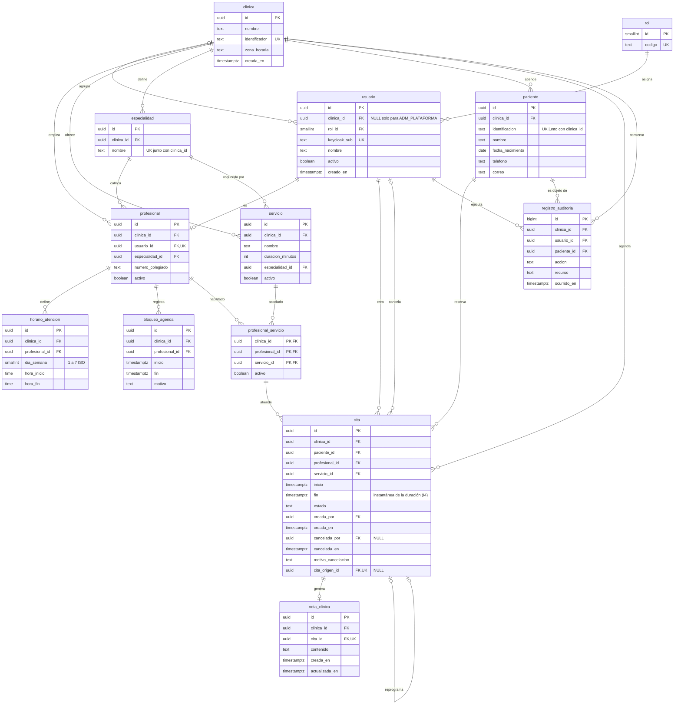

# MediCitas, Etapa 1: modelo lógico (borrador)

Este documento recoge el modelo lógico de la Etapa 1. El diagrama equivalente está en el tablero de Miro "Proyecto MediCitas". La comparación escrita de estrategias de multi-tenancy y la decisión de aislamiento con sus trade-offs van en un apartado aparte del documento de diseño final; aquí solo aparece lo que esa decisión impone al esquema.

## 1. Decisiones base

| Tema | Decisión | Motivo |
|---|---|---|
| Motor relacional | PostgreSQL (confirmado por el grupo; el enunciado deja el motor libre) | Permite restricciones de exclusión sobre rangos, que son la forma natural de sostener I1 e I2 en el motor |
| Multi-tenancy | Columna discriminadora `clinica_id` con claves foráneas compuestas `(clinica_id, id)`. RLS queda como capa opcional | El motor impide que una fila de una clínica referencie datos de otra (I5) sin depender solo de la aplicación |
| Identificadores | `uuid` | Evita enumerar recursos entre clínicas |
| Tiempo | Instantes en `timestamptz`. Horarios semanales como `time` en hora local, interpretados con `clinica.zona_horaria` | Las citas y bloqueos son instantes absolutos. El horario semanal es una regla local que se repite |
| Identidad | El esquema no guarda credenciales. `usuario.keycloak_sub` enlaza con el proveedor | Lo exige el enunciado |

## 2. Tablas

Las columnas y tipos están en el diagrama de la sección 8 y en Miro. Esta tabla resume claves y restricciones.

| Tabla | PK | Únicas | Claves foráneas | CHECK y otras restricciones |
|---|---|---|---|---|
| `clinica` | `id` | `identificador` | | |
| `rol` | `id` | `codigo` | | Datos fijos: 1 ADM_PLATAFORMA, 2 ADM_CLINICA, 3 RECEPCION, 4 PROFESIONAL |
| `especialidad` | `id` | `(clinica_id, nombre)`, `(clinica_id, id)` | `clinica_id` a `clinica` | Catálogo propio de cada clínica, lo mantiene el administrador de clínica |
| `usuario` | `id` | `keycloak_sub`, `(clinica_id, id)` | `clinica_id` a `clinica` (admite NULL), `rol_id` a `rol` | `(rol_id = 1) = (clinica_id IS NULL)` |
| `profesional` | `id` | `usuario_id`, `(clinica_id, id)` | `(clinica_id, usuario_id)` a `usuario(clinica_id, id)`, `(clinica_id, especialidad_id)` a `especialidad(clinica_id, id)` | |
| `servicio` | `id` | `(clinica_id, nombre)`, `(clinica_id, id)` | `clinica_id` a `clinica`, `(clinica_id, especialidad_id)` a `especialidad(clinica_id, id)` | `duracion_minutos > 0` |
| `profesional_servicio` | `(clinica_id, profesional_id, servicio_id)` | | `(clinica_id, profesional_id)` a `profesional`, `(clinica_id, servicio_id)` a `servicio` | |
| `horario_atencion` | `id` | | `(clinica_id, profesional_id)` a `profesional` | `dia_semana` entre 1 y 7, `hora_fin > hora_inicio`, sin solape de bloques del mismo profesional y día |
| `bloqueo_agenda` | `id` | | `(clinica_id, profesional_id)` a `profesional` | `fin > inicio` |
| `paciente` | `id` | `(clinica_id, identificacion)`, `(clinica_id, id)` | `clinica_id` a `clinica` | |
| `cita` | `id` | `(clinica_id, id)`, `cita_origen_id` | `(clinica_id, paciente_id)` a `paciente`, `(clinica_id, profesional_id, servicio_id)` a `profesional_servicio`, `(clinica_id, creada_por)` y `(clinica_id, cancelada_por)` a `usuario`, `(clinica_id, cita_origen_id)` a `cita` | `fin > inicio`, `estado` en los cinco valores, campos de cancelación completos si y solo si el estado es CANCELADA, restricciones de exclusión de I1 e I2 |
| `nota_clinica` | `id` | `cita_id` | `(clinica_id, cita_id)` a `cita(clinica_id, id)` | |
| `registro_auditoria` | `id` | | `(clinica_id, usuario_id)` a `usuario`, `(clinica_id, paciente_id)` a `paciente` | `accion` en LECTURA o ESCRITURA, `recurso` en NOTA_CLINICA o CONTACTO_PACIENTE |

Notas sobre el modelo:

- `cita` referencia a `profesional_servicio` con tres columnas. Así el motor garantiza que solo se agenda un servicio que el profesional tiene habilitado.
- `cita_origen_id` es única: una cita reprogramada tiene como máximo una sucesora.
- `especialidad` es una tabla nueva respecto al modelo conceptual y es propia de cada clínica: el administrador de clínica la gestiona, igual que sus servicios y profesionales. La clave compuesta impide que un servicio o un profesional use una especialidad de otra clínica.
- Alternativa considerada: un catálogo global con una tabla intermedia `clinica_especialidad`. Se descartó porque la matriz de permisos no asigna a nadie el mantenimiento de un catálogo global (el administrador de plataforma solo da de alta clínicas). Si más adelante se quieren unificar nombres entre clínicas, por ejemplo para la analítica de la Etapa 2, se puede reconsiderar.

## 3. Estados de la cita y qué es "vigente"

Criterio del grupo: una cita es vigente mientras exista, es decir, mientras no esté cancelada ni reprogramada. En la práctica:

| Estado | Ocupa agenda | Tipo |
|---|---|---|
| RESERVADA | Sí | Inicial |
| ATENDIDA | Sí | Final |
| AUSENTE | Sí | Final |
| CANCELADA | No | Final |
| REPROGRAMADA | No | Final |

Las restricciones de exclusión de I1 e I2 se aplican solo a los estados que ocupan agenda. Cancelar o reprogramar saca la cita de ese conjunto y libera el espacio dentro de la misma transacción (I7). Las citas atendidas y ausentes siguen ocupando su intervalo para que el historial nunca tenga dos citas solapadas.

Reprogramar no edita la cita: marca la antigua como REPROGRAMADA y crea una nueva con `cita_origen_id` apuntando a ella. Por eso `inicio`, `fin`, `profesional_id` y `servicio_id` nunca necesitan cambiar después de creada la cita.

## 4. Normalización hasta 3FN

Todas las tablas tienen clave primaria simple, salvo `profesional_servicio`. Por eso no hay dependencias parciales en ellas (2FN). En `profesional_servicio`, el único atributo no clave, `activo`, depende de la clave completa.

| Tabla | Dependencias funcionales relevantes | Resultado |
|---|---|---|
| `clinica`, `rol` | `id` determina el resto | 3FN |
| `especialidad` | `id` y `(clinica_id, nombre)` son claves candidatas | 3FN |
| `usuario` | `id` determina el resto. `keycloak_sub` es clave candidata. Los datos del rol viven en `rol` | 3FN |
| `profesional` | `id` determina el resto. `usuario_id` es clave candidata, así que `clinica_id`, que también se deduce de él, no es dependencia transitiva | 3FN |
| `servicio` | `id` y `(clinica_id, nombre)` son claves candidatas. El nombre de la especialidad vive en `especialidad` | 3FN |
| `paciente` | `id` y `(clinica_id, identificacion)` son claves candidatas | 3FN |
| `nota_clinica` | `id` y `cita_id` son claves candidatas. El profesional autor no se guarda, porque `cita_id` determina `profesional_id` y guardarlo sería una dependencia transitiva | 3FN |
| `registro_auditoria` | `id` determina el resto | 3FN |
| `horario_atencion`, `bloqueo_agenda`, `profesional_servicio`, `cita` | `clinica_id` se deduce de `profesional_id` o `paciente_id`, que no son claves candidatas | Desnormalización 1 |
| `cita` | `fin` depende de `inicio` y de la duración vigente al reservar | Desnormalización 2 |

## 5. Desnormalizaciones deliberadas

### 5.1 `clinica_id` repetido en las tablas hijas

- **Qué rompe:** en `horario_atencion`, `bloqueo_agenda`, `profesional_servicio` y `cita`, `clinica_id` se deduce de otra clave foránea, lo que es una dependencia transitiva.
- **Por qué se acepta:** es lo que permite las claves foráneas compuestas `(clinica_id, id)`. Con ellas, una fila de la clínica A no puede referenciar un profesional, paciente o servicio de la clínica B aunque la aplicación tenga un error.
- **Costo:** una columna más por tabla y una restricción única adicional `(clinica_id, id)` en las tablas referenciadas.
- **Alternativas consideradas:** claves foráneas simples con la clínica validada solo en la aplicación (frágil), triggers de verificación (más código y más puntos de fallo) y RLS (aísla las lecturas, pero no impide por sí sola una referencia cruzada al escribir).

### 5.2 `cita.fin` como instantánea

- **Qué rompe:** `fin` se podría calcular como `inicio` más la duración del servicio.
- **Por qué se acepta:** la duración del servicio puede editarse después. Si `fin` se calculara con la duración actual, cambiar un servicio movería citas ya reservadas y violaría I4. Además, la restricción de exclusión necesita el intervalo guardado en la propia fila.
- **Costo:** `fin` debe coincidir con `inicio` más la duración al momento de reservar. Lo asegura la lógica de reserva, que lo toma del servicio dentro de la transacción.
- **Alternativa equivalente:** guardar `duracion_minutos` como instantánea y derivar `fin` con una columna generada.

## 6. Invariantes y mecanismo que los sostiene

| Invariante | Mecanismo | ¿Lo resuelve el esquema? |
|---|---|---|
| I1 | `EXCLUDE USING gist (profesional_id WITH =, tstzrange(inicio, fin, '[)') WITH &&) WHERE (estado IN ('RESERVADA','ATENDIDA','AUSENTE'))`. Requiere la extensión `btree_gist` | Sí |
| I2 | La misma restricción con `paciente_id`. La clínica queda fijada por la clave compuesta | Sí |
| I3 | Validación de horario y bloqueos dentro de la transacción de reserva, con un bloqueo de fila sobre el profesional para que un bloqueo nuevo no se cuele durante la reserva | No, es lógica transaccional |
| I4 | `cita.fin` como instantánea. Opcional: trigger que rechace cambios de `inicio`, `fin`, `profesional_id` y `servicio_id` | Parcial |
| I5 | Claves foráneas compuestas. El `clinica_id` sale siempre del token, nunca de parámetros. RLS como capa opcional | Sí, junto con la aplicación |
| I6 | Privilegios del rol de la aplicación (sin UPDATE, DELETE ni TRUNCATE), con un trigger como segunda barrera | Sí, a nivel de motor |
| I7 | Los estados CANCELADA y REPROGRAMADA quedan fuera del predicado de las exclusiones | Sí, la visibilidad inmediata depende de la caché |
| I8 | Invalidación de la caché de disponibilidad después del commit | No, es política de caché |

Respuesta del motor a la pregunta rectora: dos reservas simultáneas del último espacio compiten en la restricción de exclusión. La segunda espera a que la primera termine y, si esa se confirma, recibe una violación de exclusión (SQLSTATE `23P01`) que la aplicación traduce a 409. En casos raros el motor puede detectar un deadlock (`40P01`), y la aplicación debe tratarlo también.

Otras reglas que el esquema solo puede reforzar con triggers y que el diseño deja a la lógica transaccional:

- Transiciones válidas de estado (RF13). Un trigger opcional puede rechazar cualquier cambio cuando `OLD.estado` no es RESERVADA.
- Una nota clínica solo existe sobre una cita ATENDIDA (RF15), y solo la escribe el profesional de esa cita. Se verifica uniendo con `cita` y `profesional`.
- Un profesional solo se asocia a servicios cuya especialidad requerida coincide con la suya (RF3 y RF4).

## 7. Cambios respecto al modelo conceptual

1. Se agrega `especialidad` como tabla propia de cada clínica, y `profesional.especialidad_id` y `servicio.especialidad_id` pasan a ser claves foráneas compuestas con `clinica_id`.
2. Las relaciones del conceptual se materializan como claves foráneas, la mayoría compuestas con `clinica_id`.
3. `profesional_servicio` toma como clave primaria las tres columnas `(clinica_id, profesional_id, servicio_id)`.
4. `registro_auditoria` guarda `accion` y `recurso` como textos con CHECK, no como tablas catálogo.

## 8. Diagrama entidad-relación

## 9. Decisiones abiertas

1. **Horario sin vigencia.** `horario_atencion` no tiene fechas de inicio y fin, así que un cambio de horario se aplica hacia adelante y no deja historial. Si se quiere historial, hay que agregar un rango de vigencia.
2. **Baja lógica de usuario.** `usuario.activo` existe, pero un token válido sigue funcionando hasta que expire. Hay que decidir si la aplicación verifica `activo` en cada solicitud y si además se deshabilita al usuario en Keycloak.
3. **Quién lee notas clínicas.** La matriz de permisos solo permite al profesional las notas "de citas propias". Falta confirmar que ese es el criterio también para la lectura y que cada lectura se audita (RF18).
